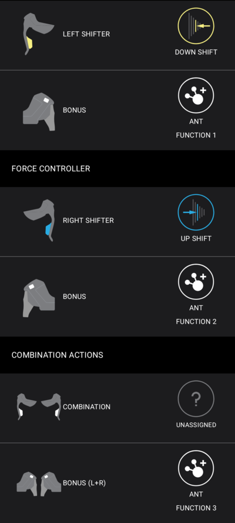
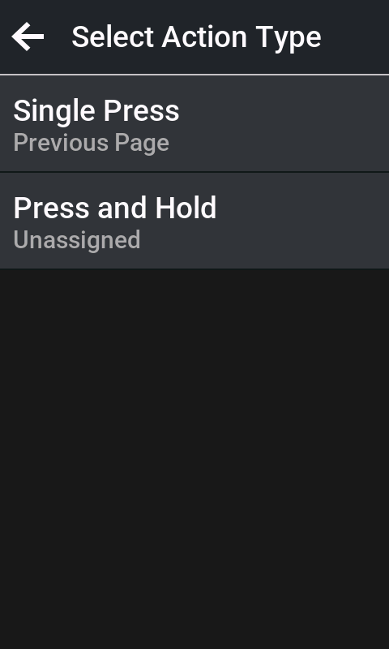
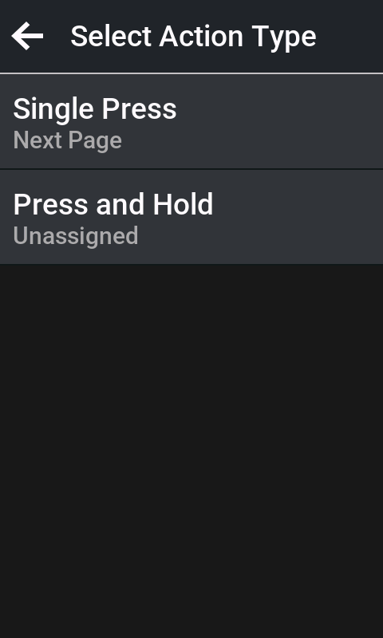
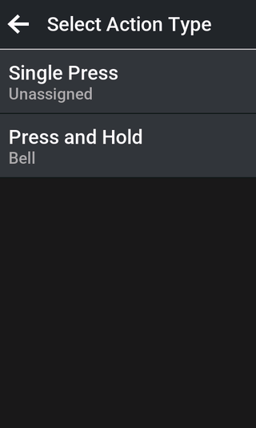

# AXS-Counter <!-- omit in toc -->

[](https://creativecommons.org/licenses/by-sa/4.0/)
[](https://www.elecrow.com/store/Binary-6)
[](https://github.com/Chrismettal#donations)

ConnectIQ data field for **Garmin Edge devices** that counts **SRAM Force AXS bonus-button** presses over `ANT+`.

Used like these clicker counters to count arbitrary numbers during cycling. (How many peoples did I pass? How many turns did I have in the group ride?)

**If you like my work please consider [supporting me](https://github.com/Chrismettal#donations)!**

## Table of contents <!-- omit in toc -->

- [Concept](#concept)
- [Installation](#installation)
  - [Sideloading](#sideloading)
  - [ConnectIQ Store](#connectiq-store)
- [Settings](#settings)
  - [Example Configuration](#example-configuration)
    - [AXS App settings](#axs-app-settings)
    - [Garmin Ant function 1](#garmin-ant-function-1)
    - [Garmin Ant function 2](#garmin-ant-function-2)
    - [Garmin Ant function 3](#garmin-ant-function-3)
- [Build](#build)
- [Release](#release)
- [How it works](#how-it-works)
- [AI Usage](#ai-usage)
- [Donations](#donations)
- [License](#license)

## Concept

A big number on a data page that changes when you press the SRAM bonus buttons. A dot in the corner shows the ANT+ link: **green** while the shifter is broadcasting, **red** when no frames are arriving (SRAM asleep, out of range, or channel lost).

Each of the three actions - **Increment**, **Decrement** and **Reset** - can be bound to any of the bonus-button combinations (ANT+ Function Set 1–8 × short/long press), or left unassigned. Defaults: Increment = **FS 3 · short press** (both buttons), Decrement and Reset unassigned.

## Installation

### Sideloading

1. Download the `.prg` matching your device from the latest release. There is one file per device (Garmin requires sideloads to be built for the exact device):

| Device    | File                       |
| --------- | -------------------------- |
| Edge 540  | `AXS-Counter-edge540.prg`  |
| Edge 550  | `AXS-Counter-edge550.prg`  |
| Edge 840  | `AXS-Counter-edge840.prg`  |
| Edge 850  | `AXS-Counter-edge850.prg`  |
| Edge 1040 | `AXS-Counter-edge1040.prg` |
| Edge 1050 | `AXS-Counter-edge1050.prg` |
| Edge 1060 | `AXS-Counter-edge1060.prg` |

2. Connect the Edge to your computer via USB and copy the file into the `Garmin/Apps` directory.

3. Unplug the USB. The Edge will install the app and prompt you to use it.

You'll find the datafield in the "ConnectIQ" category.

### ConnectIQ Store

Not yet available

## Settings

Each of the three actions can be bound to one button combination, or left *Unassigned*:

| Setting       | Action                                   |
| ------------- | ---------------------------------------- |
| **Increment** | counter +1 (default: FS 3 · short press) |
| **Decrement** | counter −1 (default: Unassigned)         |
| **Reset**     | counter → 0 (default: Unassigned)        |

FS1 - FS16 correlate to the 16 ANT actions SRAM can send us. Along with that each ANT action can be either long or short press.

Thus, if you set up your SRAM bonus button left to send the ANT 1 action, you can use "FS1 - Short" to increment the counter on short button press.

This does NOT use the Edge's bonus button assignment since Garmin's Firmware doesn't let datafields hook into this. Instead this datafield just looks at the data coming in parallel to Garmin.

This means you want to leave the buttons you want to use for this counter unassigned in Garmin's settings.

### Example Configuration

In this example configuration I use short press on both buttons to increment, with no option to decrement or reset.

The Edge itself listents to left and right short presses for page swapping and holding of both for bell ringing.

You could also double bind between the Edge and this datafield if you wanted to.

#### AXS App settings



#### Garmin Ant function 1



#### Garmin Ant function 2



#### Garmin Ant function 3



## Build

Builds are done per device (one `.prg` per target; this is also how the release is packaged):

```
monkeyc -f src/project.jungle -d edge1050 -y ~/.Garmin/ConnectIQ/developer_key.der -o _gitignored/Builds/AXS-Counter-edge1050.prg -w
```

Replace `edge1050` with any of the supported device ids: `edge540`, `edge550`, `edge840`, `edge850`, `edge1040`, `edge1050`, `edge1060`.

Sideload the resulting `.prg` to the matching Edge (MTP → `Garmin/Apps`), then put the **Counter** field on a data page.

## Release

Releases are manual (no CI): build one `.prg` per supported device and attach all of them to a [GitHub release](../../releases).

1. Build every target from the list above into `_gitignored/Builds/`, naming the output `AXS-Counter-<device>.prg`.
2. Create the release with `gh release create vX.Y.Z` and attach the `.prg` files.
3. Update the [Sideloading](#sideloading) table if the device list changes.

A single `.prg` cannot be shared across devices: Garmin sideloads must be built for the exact device, so the release carries one file per model. (A future Connect IQ Store submission would instead be a single `.iq` export containing all device builds.)

## How it works

The bonus buttons are exposed by SRAM as ANT+ *function sets* on the **Shifting profile (device type 0x22)**. The shifter broadcasts a **data page 2** frame about once per second while it is awake:

```
[2, counter, newest, e2, e3, e4, e5, 0]
```

- byte 0 = `2` (button page)
- byte 1 = event counter, increments on every press
- bytes 2..6 = last 5 events, most recent first
- event byte = `functionSet | (longPress ? 0x20 : 0)` — `1` = left, `2` = right, `3` = both; `33`/`34`/`35` = long presses

The app taps the Edge's **native ANT+ Shifting channel** (`AntPlus.Shifting` + `ShiftingListener.onMessage`) — no raw channel, no device number, no background scan. A new press is detected by the event counter changing; the newest event is then byte 2.

Requirements:

- The Edge is already paired to the SRAM on its built-in shifting channel.
- The SRAM is awake and the bonus buttons are mapped to ANT+ Function Sets in the SRAM AXS app (SRAM currently exposes FS 1–3; the settings allow binding any FS 1–8).

## AI Usage

This codebase was mostly meatproxied through `Qwen3.8-27B:Q4_K_XL` at `100k` context running on a `7900XTX` locally.

## Donations

**If you like my work please consider [supporting me](https://github.com/Chrismettal#donations)!**

## License

 <a rel="CClicense" href="http://creativecommons.org/licenses/by-sa/4.0/"></a><br />This work is licensed under a <a rel="license" href="http://creativecommons.org/licenses/by-sa/4.0/">Creative Commons Attribution-ShareAlike 4.0 International License</a>.
